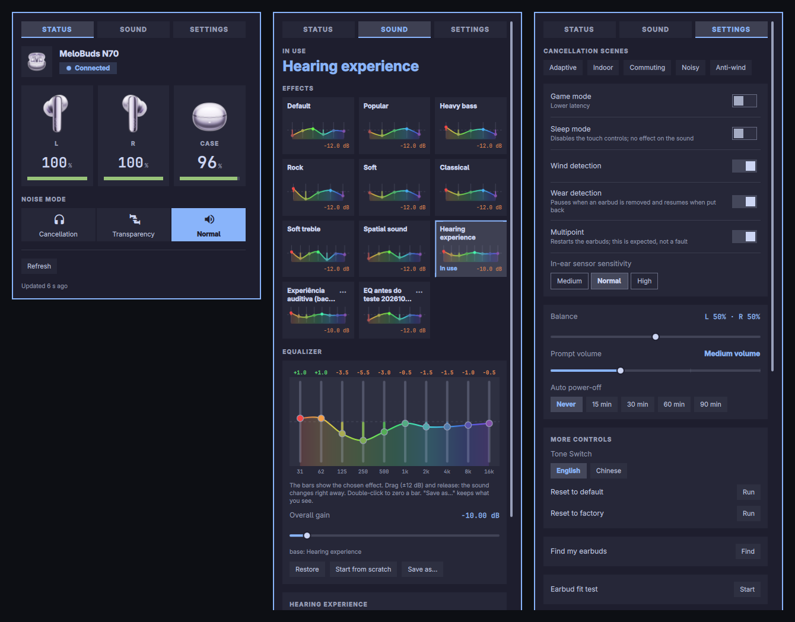

<div align="center">

# QCY Earbuds for Omarchy

Battery, noise control, equalizer and settings for QCY earbuds, from the Omarchy shell bar.

[](https://github.com/bbztp/qcy-omarchy/actions/workflows/ci.yml)
[](LICENSE)
[](https://github.com/bbztp/qcy-omarchy/releases)
[](go.mod)




</div>

A bar widget for the [Omarchy](https://omarchy.org) shell. It talks to the earbuds
directly over Bluetooth Low Energy, with no phone and no vendor app. It speaks
the vendor's low-energy GATT protocol and works for **QCY earbuds in general**:
each model offers what its own product panel declares, so controls such as the
equalizer, touch keys or noise modes appear only when the model has them.

> **Hardware status.** So far it has been tested on real hardware with the
> **MeloBuds N70** only. Other models are driven from their declared panel and
> covered by automated tests, but have not been exercised on a device. See
> [Supported models](#supported-models) and [Contributing](#contributing).

## What it does

Availability depends on the model's panel; the list below is the full set.

| Area | Features |
| --- | --- |
| Battery | Left, right and case as pictures with a level bar (red below 20%, amber to 49%, green from 50%) and charging flags. |
| Noise control | Off, Adaptive, Indoor, Commuting, Noisy, Anti-wind, Transparency. |
| Toggles | LDAC (hi-res audio), Multipoint, Game mode (low latency), Sleep mode, Wind noise reduction. |
| Equalizer | Effect library and a band editor (10 bands, 31 Hz to 16 kHz; range from the model's panel, ±12 dB on the N70), with a personal library of saved curves. |
| Settings | Prompt volume, wear-sensor sensitivity, ear-tip fit test with a result per ear, touch controls, balance, auto power-off; value sets come from the model's panel. |
| Readout | Firmware, EQ preset and curve, balance, auto power-off, prompt volume. |

### Highlights

- **Fast.** A small user daemon, `qcyctld`, holds the BLE connection so the widget's calls are quick.
- **Polite.** The earbuds accept one BLE client at a time, so the daemon releases them after an idle window (6 s by default) and your phone can reconnect.
- **Scriptable.** `qcyctl` is the matching Go CLI; see [docs/CLI.md](docs/CLI.md).
- **Careful with EQ.** The active slot is backed up before every EQ write.
- **Translatable.** English by default, ships with Português (Brasil); add a language with one JSON file.

## Requirements

- Omarchy (Quickshell-based shell).
- systemd (user session) to run the `qcyctld` daemon.
- The earbuds paired with the machine.
- [Go](https://go.dev), only if you build from source.

## Installation

```sh
omarchy plugin add https://github.com/bbztp/qcy-omarchy --enable
```

The shell may need `omarchy restart shell` once to pick the plugin up. Then add
the widget to your bar (`bar.layout` in `~/.config/omarchy/shell.json`, which
hot-reloads on save):

```json
{ "id": "io.github.bbztp.qcy" }
```

or run `omarchy bar move io.github.bbztp.qcy --section right`.

**First open.** The plugin prepares everything itself, and the panel shows
"Preparing QCY…" meanwhile. It downloads the `qcyctl`/`qcyctld` release matching
its version, checks its SHA-256 and installs both to the plugin's own hidden
`.bin` directory (`~/.config/omarchy/plugins/io.github.bbztp.qcy/.bin`), so
removing the plugin removes them; if that directory is not writable they go to
`~/.local/share/qcy-omarchy/bin` instead. Nothing runs as root and nothing is
executed before the checksum matches.

If no release can be downloaded (offline, unpublished version), the plugin builds
from source instead. That needs Go (`sudo pacman -S go`) and the repository's
`cmd/` tree. The same step by hand: `QCY_BUILD=1 scripts/bootstrap.sh`. If
preparation fails, the panel says why and offers "Try again".

When the plugin is updated, the binaries are replaced on the next open.
`qcyctl version` prints the version, which matches `manifest.json`.

## Usage

| Input | Action |
| --- | --- |
| Left click on the bar button | Open the panel. |
| Right click on the bar button | Refresh. |
| `Esc` in the panel | Close. |
| `r` in the panel | Refresh. |
| `1` / `2` / `3` in the panel | Switch tab. |

The full state is read on connect and when the panel opens (the panel shows
`Reading…` meanwhile). The bar button shows the QCY wordmark.

| Tab | Content |
| --- | --- |
| **Status** | Earbuds picture and connection state, battery (left, right, case), noise mode. |
| **Sound** | The effect library (click a card to apply it) and the 10-bar equalizer. Drag a bar and release to apply, double-click to zero it. **Start from scratch** drops the base effect so the bars are the whole curve; **Save as…** stores what you see in the curve library. Bars are written on top of the effect as a curve in slot 255. |
| **Settings** | Noise scenes, toggles, balance, auto power-off, prompt volume, sensor sensitivity, fit test, touch controls, device info, language, daemon. |

On any other model the panel offers what that model's panel declares (equalizer
bands and range, touch keys, prompt volume steps, noise modes, ...). Features
whose encoding is not understood yet are listed in Settings > Device under
"Not available on this model".

## Supported models

The daemon identifies the model by the 16-bit `vendorId` in the earbuds'
advertisement, not by the Bluetooth name.

| vendorId | Model | Profile |
| --- | --- | --- |
| 23872, 23877 | MeloBuds N70 | **Tested on hardware**: everything above, including EQ, touch keys and the hearing test. |
| any other id in the embedded QCY product list (191 models with a panel) | `qcy-<vendorId>` | Everything the model's panel declares and this tool understands: noise control, EQ, touch keys, fit test, prompt volume, sensor sensitivity, toggles. **Not yet tested on hardware**: the panel shows "Not tested on this model yet". |
| unknown | name, then firmware string, then `generic` | |

Where the product data comes from and how the profile is derived:
[docs/WEB_API.md](docs/WEB_API.md).

## Languages

The panel follows your system language (`LC_ALL`, `LC_MESSAGES`, `LANG`). To
override it, pick a language under Settings > Language (Automatic restores the
system's), or run `qcyctl i18n set <code|auto>`.

To add a language, no code changes are needed:

```sh
mkdir -p ~/.config/qcy-omarchy/i18n
qcyctl i18n template > ~/.config/qcy-omarchy/i18n/es.json
```

Edit `es.json`: set `_name` to the language's own name (shown in the picker),
`_decimal` to its decimal separator, and translate the values (the keys are the
English texts; keep `{n}`, `{name}`... markers as they are). Untranslated or empty
entries fall back to English. Then choose the language in the panel.
`qcyctl i18n list` shows what was found; an invalid file is skipped with a warning
on stderr. A file named `pt-BR.json` overrides entries of the shipped one;
`pt.json` is the fallback for any `pt-*`. User files live outside the plugin
directory, so reinstalling the plugin keeps them.

## Configuration

Per widget in `shell.json` (or in the shell's settings UI):

| Key | Default | Meaning |
| --- | --- | --- |
| `scanSeconds` | `10` | How long to listen for the earbuds' advertisement (5-60 in the settings UI; values below 5 are raised to 5). |
| `deviceMatch` | `"qcy"` | Case-insensitive substring to recognise your earbuds. |

Set `QCYCTL` in the environment to point the widget at a `qcyctl` binary that is
not in `~/.local/bin`. Settings > Daemon turns the `qcyctld` user service on or
off at login. Other environment variables: [docs/CLI.md](docs/CLI.md#environment-variables).

## Known limitations

- **Case charging.** The MeloBuds N70 (firmware 3.0.13) reports the case's battery
  level but never sets the "charging" flag for it, so the case does not show a
  charging state. The widget already draws one (charge tone, pulse, bolt) and uses
  it whenever a model or firmware reports the flag.
- **Only the MeloBuds N70 has been tested on hardware.** Other models get what
  their panel declares; a feature whose encoding is not understood is absent and
  listed in the panel under "Not available on this model" (see
  [Supported models](#supported-models)). The hearing test is driven for the N70
  only. Problems on other models are expected and are fixed through pull requests
  (see [Contributing](#contributing)).

## Troubleshooting

| Symptom | Cause and fix |
| --- | --- |
| Error "earbuds are in use by another app" (`busy`) | The phone app or another client holds the earbuds. Close it or switch it off; the panel recovers on the next refresh. |
| Panel shows stale data | The last known state is shown while the earbuds are busy. Right-click the button or press `r` to refresh. |
| Preparation failed | The panel says why; use "Try again". Offline or unpublished version: install Go and see [Installation](#installation). |
| Need logs | Daemon output is in `${XDG_STATE_HOME:-~/.local/state}/qcy-omarchy/qcyctld.log`. Run `qcyctl daemon status` for its state. |
| Need a GATT trace | `QCY_DEBUG=1` for the CLI; `QCYCTL_DEBUG=1` for the daemon. See [docs/CLI.md](docs/CLI.md#environment-variables). |

## Uninstall

- If you turned on Settings > Daemon > "Start with the system", turn it off
  first (or run `qcyctl daemon uninstall-service`): the unit points into the
  plugin directory.
- Optional: Settings > Daemon > "Remove QCY data…" stops the service and deletes
  `~/.local/share/qcy-omarchy`, `~/.config/qcy-omarchy` and `~/.cache/qcy-omarchy`
  (your effects, settings, backups and cache; the program is not touched).
- Then run `omarchy plugin remove io.github.bbztp.qcy`. It deletes the plugin
  directory, including the binaries in `.bin`; a still-running `qcyctld` notices
  that its executable is gone and exits within about 30 s.
- Remove the `{ "id": "io.github.bbztp.qcy" }` entry from `shell.json`.

For a development install, `make uninstall` disables and removes the
`qcyctld.service` user unit, `~/.local/bin/qcyctl` and `qcyctld`, and the plugin
directory, then rescans plugins. Backups in `~/.local/share/qcy-omarchy/backups/`
are left in place.

## Development

```sh
git clone https://github.com/bbztp/qcy-omarchy
cd qcy-omarchy
make build            # qcyctl and qcyctld
go test ./...         # unit tests
./scripts/install.sh  # build + install + start the user service
```

`scripts/install.sh` installs the binaries to `~/.local/bin`, installs and starts
the `qcyctld.service` user unit, copies the plugin to
`~/.config/omarchy/plugins/io.github.bbztp.qcy` and rescans plugins. Pass
`--no-service` to skip the unit, `--no-build` to reuse `make build` output.
`make install` does the same. The bootstrap test (local HTTP server, fake
release) is `scripts/bootstrap_test.sh`.

```
cmd/qcyctl/                 Go source for qcyctl
cmd/qcyctld/                Go source for the qcyctld daemon
internal/                   Go packages shared by both (qcycore, hearing, protocol)
docs/                       CLI.md, PROTOCOL.md, WEB_API.md, PUBLISHING.md
packaging/qcyctld.service   systemd user unit
manifest.json, *.qml, qmldir, assets/  the Omarchy bar widget (QML plugin, at the repo root)
scripts/                    install, bootstrap, release packaging
```

## Documentation

- [docs/CLI.md](docs/CLI.md): `qcyctl` commands, daemon lifecycle, environment variables, EQ slots, safety notes.
- [docs/PROTOCOL.md](docs/PROTOCOL.md): the BLE protocol as observed.
- [docs/WEB_API.md](docs/WEB_API.md): product data and model profiles.
- [docs/PUBLISHING.md](docs/PUBLISHING.md): release process, for maintainers.
- [CHANGELOG.md](CHANGELOG.md): version history.

## Contributing

Only the N70 can be tested by the maintainer, so **fixes for other models come
from people who own them, as pull requests**. If a control misbehaves on your
model:

1. Reproduce it with `qcyctl` and capture the output of `qcyctl status --json`
   (it carries your model's `vendorId`, declared features and notes) and, if
   useful, a trace with `QCY_DEBUG=1`.
2. Open a pull request with the fix and a test. Model-specific behaviour is driven
   by the embedded panel data; see [docs/WEB_API.md](docs/WEB_API.md) and
   [docs/PROTOCOL.md](docs/PROTOCOL.md). Say which model and firmware you tested on.
3. Run `go test ./...` and `gofmt -l .` before sending it.

Issues are welcome for questions and reports, but without a device to reproduce
on they can only be resolved by a contributor who has one. Translations are a
single JSON file (see [Languages](#languages)).

## Credits

Protocol work builds on the public work in
[Quicky](https://github.com/hui1601/Quicky) and
[OpenQCY-Desktop](https://github.com/GiorgioRafael/OpenQCY-Desktop).

## License

MIT. See [LICENSE](LICENSE).

## Disclaimer

This is an unofficial project. It is not affiliated with or endorsed by QCY. QCY,
MeloBuds and other names are trademarks of their owners.
